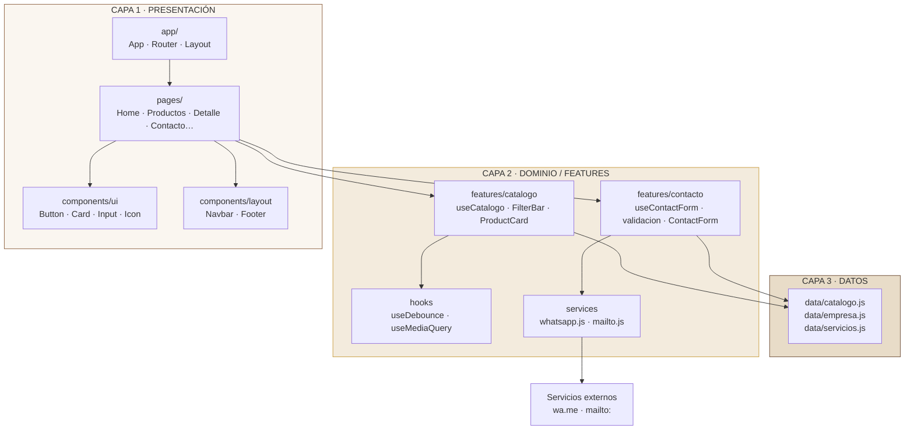
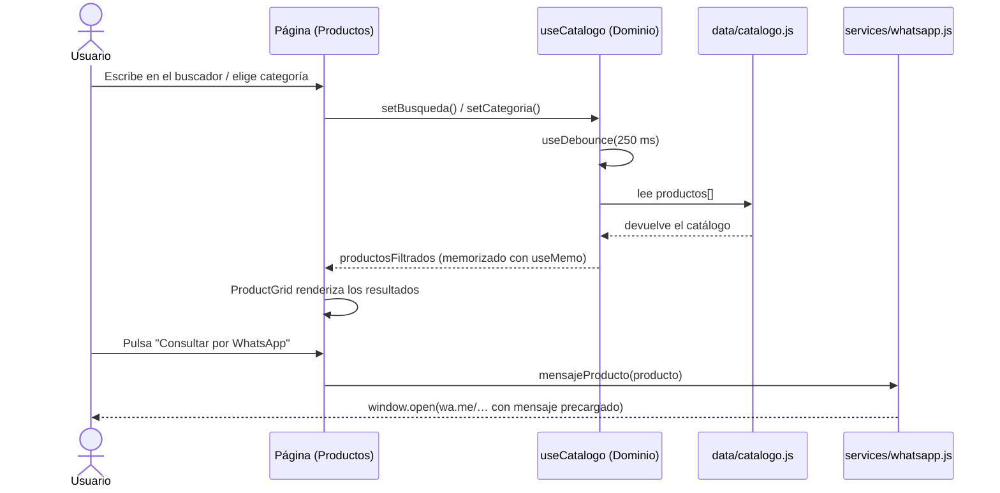
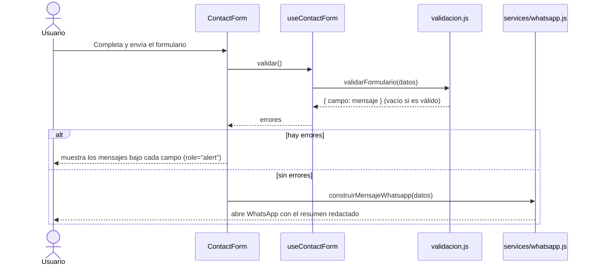
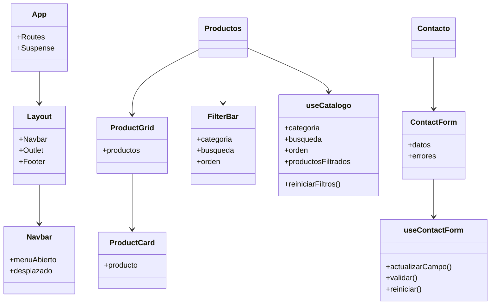
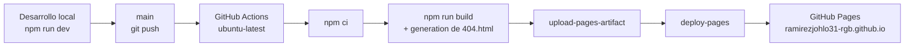

# Arquitectura del Sistema

**Proyecto:** Sitio web Industrias Mazzelli-Perú Cueros E.I.R.L.
**Autor:** Johan Brayan Ramírez Ccoyllo
**Versión del documento:** 1.0 — Avance 1 (Semana 8)

---

## 1. Contexto y alcance

Industrias Mazzelli-Perú Cueros E.I.R.L. es un taller de curtido vegetal y
confección de artículos de cuero con presencia en Lima. El RCU solicita un
**sitio web corporativo** que comunique la marca, exhiba el catálogo de
productos y facilite el contacto comercial.

### Dentro del alcance

- Catálogo de productos con filtros, búsqueda y ordenamiento.
- Fichas de producto con especificaciones y llamada a la acción.
- Contenido institucional (nosotros, proceso artesanal, galería del taller).
- Servicios B2B (producción a medida, venta mayorista, corporativos).
- Formulario de contacto con salida a WhatsApp y correo electrónico.

### Fuera del alcance (avance 1)

- Panel de administración y base de datos.
- Carrito de compras y pasarela de pago.
- Cuentas de usuario y área privada.
- Multi-idioma.

> El modelo de datos ya está desacoplado (`src/data/catalogo.js`), por lo que
> incorporar una API o un CMS en una fase posterior no obliga a reescribir la
> capa de presentación.

---

## 2. Estándares de arquitectura

| Estándar                                          | Aplicación en el proyecto                                                                               |
| ------------------------------------------------- | ------------------------------------------------------------------------------------------------------- |
| **Modelo-Vista-Controlador (MVC)**                | Controlador → React Router (rutas); Modelo → capa `data/`; Vista → `pages/` + `components/`             |
| **Arquitectura por capas**                        | Separación estricta entre presentación, dominio y datos                                                 |
| **Separación de responsabilidades (SoC)**         | Cada módulo tiene una responsabilidad única y un punto de entrada claro                                 |
| **Principio de inversión de dependencias**        | Las vistas dependen de hooks, no de la fuente de datos: el hook puede cambiar de fuente sin tocar la UI |
| **Programación orientada a features**             | El código se organiza por módulo de negocio (`features/catalogo`, `features/contacto`)                  |
| **Componentes_presentacionales vs. contenedores** | `ProductCard` (presentacional) vs. `useCatalogo` (contenedor con lógica)                                |

---

## 3. Diagrama de capas



**Regla de dependencia:** las dependencias apuntan **hacia adentro**.
La capa de datos no importa nada de la capa de dominio ni de presentación.

---

## 4. Flujo de datos



### Formulario de contacto



---

## 5. Estructura de carpetas

```
mazzelli-peru-cueros/
├── public/                      # Archivos servidos tal cual
│   ├── productos/  galeria/     # Ilustraciones SVG generadas por script
│   ├── favicon.svg  og-image.svg
│   └── robots.txt  sitemap.xml
├── docs/                        # Documentación del RCU
│   ├── ARQUITECTURA.md  REQUERIMIENTOS.md
│   ├── MODELO-DATOS.md  INFORME-TECNOLOGICO.md
│   ├── wireframes/              # Mockups SVG
│   └── slides/                  # Guion de presentación
├── scripts/
│   ├── generar-assets.mjs       # Genera los SVG de marca
│   └── generar-wireframes.mjs   # Genera los mockups
├── src/                         # Código fuente de la aplicación
└── .github/workflows/deploy.yml # Pipeline de CI/CD
```

---

## 6. Modelo de componentes



**Reglas de composición**

1. Un componente de UI genérico **no** importa datos de negocio (`Button`, `Card`, `Input`).
2. Un componente de feature **no** escribe `fetch` ni accede al `window` directamente: delega en `services/`.
3. Los hooks de dominio **no** devuelven JSX; devuelven estado y acciones.
4. Toda lista se renderiza con una `key` estable (el `id` del producto, no el índice).

---

## 7. Decisiones técnicas (ADR resumido)

### ADR-01 · React + Vite en lugar de Angular

**Contexto:** el RCU no fija stack; el sistema es un sitio corporativo de catálogo y contacto.

**Decisión:** React 19 con Vite 8.

**Alternativas:** Angular (curva de aprendizaje alta y ~180 kB de bundle base para un caso que no lo justifica), Vue (alternativa válida y con menor curva de aprendizaje, aunque con menor presencia en el mercado laboral peruano), HTML/CSS/JS puro (no permite una arquitectura por capas defendible en el avance).

**Consecuencia:** puesta en marcha inmediata (`npm run dev`), bundle inicial de 92 kB gzip y despliegue estático gratuito.

### ADR-02 · Tailwind CSS v4 con configuración CSS-first

**Decisión:** definir los tokens en `@theme` dentro de `src/styles/index.css` en lugar de un `tailwind.config.js`.

**Motivo:** la v4 elimina la configuración en JavaScript, mantiene el sistema de diseño en un único archivo y reduce la cantidad de archivos de configuración. Además permite generar utilidades semánticas (`bg-cuero-900`) a partir de los tokens de marca.

### ADR-03 · Capa de datos desacoplada

**Decisión:** el catálogo reside en `src/data/catalogo.js` como objetos JavaScript planos.

**Motivo:** permite trabajar sin servidor y, a la vez, sustituir la fuente por `fetch('/catalogo.json')` o una API real modificando **solo** `useCatalogo.js`.

### ADR-04 · Sin backend: salida a WhatsApp y correo

**Decisión:** el formulario valida en el cliente y compone un mensaje que se envía por `wa.me` o `mailto:`.

**Motivo:** cubre la necesidad real (captar contactos) con cero infraestructura, cero costos de hosting y sin exponer datos personales en un servidor propio.

### ADR-05 · Code splitting por ruta

**Decisión:** `React.lazy` + `Suspense` en `src/app/App.jsx`.

**Motivo:** reduce el bundle inicial y mejora el First Contentful Paint; cada página se descarga solo cuando se visita.

### ADR-06 · Fallback SPA en GitHub Pages

**Decisión:** plugin de Vite que genera `dist/404.html` con un script de redirección que guarda la ruta en `sessionStorage` y la restaura con `history.replaceState()`.

**Motivo:** GitHub Pages no reescribe URLs. Sin este mecanismo, recargar en `/productos` devolvería un error 404.

---

## 8. Seguridad y privacidad

| Aspecto           | Medida aplicada                                                                        |
| ----------------- | -------------------------------------------------------------------------------------- |
| Datos personales  | No se almacenan en servidor; el formulario solo compone un mensaje local               |
| Enlaces externos  | `target="_blank"` siempre con `rel="noopener noreferrer"`                              |
| Inyección de HTML | React escapa por defecto el contenido renderizado; no se usa `dangerouslySetInnerHTML` |
| Dependencias      | `npm audit` sin vulnerabilidades en el momento de la entrega                           |
| Repositorio       | Código público, sin secretos ni variables sensibles (no se requieren credenciales)     |

---

## 9. Rendimiento

| Métrica                   | Valor medido en el build de producción                      |
| ------------------------- | ----------------------------------------------------------- |
| Bundle inicial (JS)       | 288 kB · **92 kB gzip**                                     |
| CSS                       | 37 kB · **7.5 kB gzip**                                     |
| Chunk más pesado por ruta | `Contacto` 11.8 kB (3.9 kB gzip)                            |
| Recursos gráficos         | SVG (vectorial), sin imágenes rasterizadas pesadas          |
| Fuentes                   | `preconnect` a `fonts.googleapis.com` y `fonts.gstatic.com` |

---

## 10. Despliegue



**Requisito de configuración en GitHub:** `Settings → Pages → Source: GitHub Actions`.
