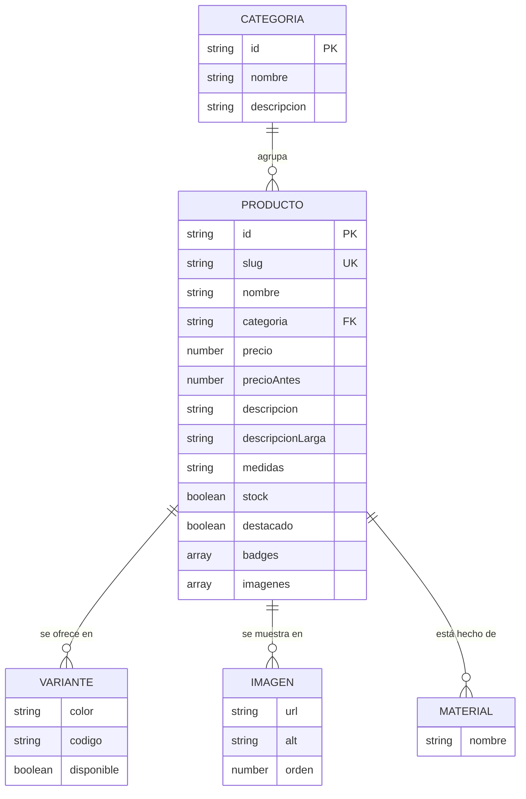
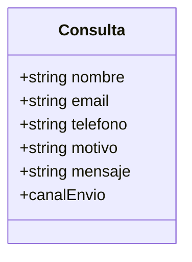
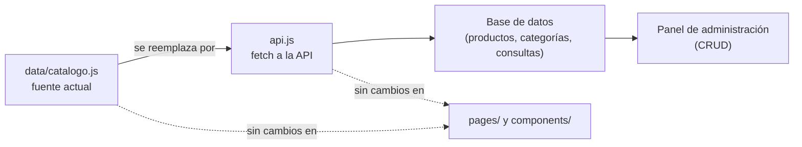

# Modelo de Datos

**Proyecto:** Sitio web Industrias Mazzelli-Perú Cueros E.I.R.L.
**Autor:** Johan Brayan Ramírez Ccoyllo
**Versión:** 1.0 — Avance 1 (Semana 8)

---

## 1. Enfoque

El proyecto es un **frontend puro** sin base de datos en el Avance 1. El modelo
de datos se define como **estructuras JavaScript tipadas por convención**
ubicadas en la capa `data/`, que actúan como el contrato entre el dominio y la
presentación.

Esta decisión permite que la fuente de datos se sustituya más adelante por una
API real **sin modificar la capa de presentación** (ver ADR-03 en
[`ARQUITECTURA.md`](ARQUITECTURA.md)).

---

## 2. Diagrama entidad-relación



---

## 3. Entidades

### 3.1 Categoría

| Campo         | Tipo   | Restricciones | Descripción                       |
| ------------- | ------ | ------------- | --------------------------------- |
| `id`          | string | PK, único     | Identificador corto en kebab-case |
| `nombre`      | string | requerido     | Nombre visible                    |
| `descripcion` | string | requerido     | Texto breve para las tarjetas     |

**Valores actuales:** `carteras`, `cinturones`, `billeras`, `mochilas`, `accesorios`.

### 3.2 Producto

| Campo              | Tipo     | Restricciones  | Descripción                  |
| ------------------ | -------- | -------------- | ---------------------------- |
| `id`               | string   | PK, único      | Código de negocio (`P-001`)  |
| `slug`             | string   | único          | Identificador de URL         |
| `nombre`           | string   | requerido      | Nombre comercial             |
| `categoria`        | string   | FK → Categoría | Categoría del producto       |
| `precio`           | number   | > 0            | Precio unitario en soles     |
| `precioAntes`      | number   | opcional       | Precio de referencia tachado |
| `descripcion`      | string   | requerido      | Resumen para la tarjeta      |
| `descripcionLarga` | string   | opcional       | Texto de la ficha            |
| `materiales`       | string[] | requerido      | Materiales empleados         |
| `medidas`          | string   | requerido      | Medidas en centímetros       |
| `colores`          | string[] | requerido      | Variantes de color           |
| `stock`            | boolean  | requerido      | Disponibilidad inmediata     |
| `destacado`        | boolean  | requerido      | Aparece en la portada        |
| `badges`           | string[] | opcional       | Etiquetas ("Más vendido")    |
| `imagenes`         | string[] | requerido      | URLs de las imágenes         |

### 3.3 Empresa

| Campo                   | Tipo   | Descripción                             |
| ----------------------- | ------ | --------------------------------------- |
| `razonSocial`           | string | Razón social completa                   |
| `nombreComercial`       | string | Nombre de marca ("Mazzelli")            |
| `descripcion`           | string | Descripción corporativa                 |
| `lema`                  | string | Lema de marca                           |
| `anioFundacion`         | number | Año de inicio                           |
| `ruc`                   | string | Registro Único de Contribuyentes        |
| `region`                | string | Ubicación geográfica                    |
| `direccion`             | string | Dirección del taller                    |
| `telefono`              | string | Número de contacto                      |
| `whatsapp`              | string | Número en formato internacional sin `+` |
| `email` / `emailVentas` | string | Correos de atención                     |
| `horario`               | string | Horario de atención                     |
| `redes`                 | array  | Redes sociales (nombre, url, icono)     |

---

## 4. Relaciones

| Relación             | Cardinalidad | Descripción                                   |
| -------------------- | ------------ | --------------------------------------------- |
| Categoría → Producto | 1:N          | Cada producto pertenece a una única categoría |
| Producto → Imagen    | 1:N          | Un producto tiene entre 1 y varias imágenes   |
| Producto → Material  | 1:N          | Un producto se compone de varios materiales   |

---

## 5. Modelo de la consulta de contacto

El formulario **no** se persiste en base de datos. Se modela como una entidad
transitoria que se valida en el cliente y se transmite como texto.



| Campo        | Tipo   | Obligatorio | Regla de validación                                   |
| ------------ | ------ | ----------- | ----------------------------------------------------- |
| `nombre`     | string | Sí          | Mínimo 3 caracteres                                   |
| `email`      | string | Sí          | Formato `usuario@dominio.tld`                         |
| `telefono`   | string | No          | Entre 8 y 20 caracteres, dígitos y signos de teléfono |
| `motivo`     | string | Sí          | Debe pertenecer a la lista de motivos                 |
| `mensaje`    | string | Sí          | Mínimo 10 caracteres                                  |
| `canalEnvio` | enum   | Sí          | `whatsapp` o `correo`                                 |

Las reglas están implementadas en `src/features/contacto/validacion.js` como
funciones puras, independientes del framework.

---

## 6. Ejemplo de registro

```json
{
  "id": "p-001",
  "slug": "cartera-soy-lima",
  "nombre": "Cartera \"Soy Lima\"",
  "categoria": "carteras",
  "precio": 189,
  "precioAntes": 229,
  "descripcion": "Cartera de hombro en cuero vacuno curtido vegetal…",
  "materiales": ["Cuero vacuno", "Lino", "Latón cepillado"],
  "medidas": "22 × 14 × 8 cm",
  "colores": ["Cognac", "Negro", "Chocolate"],
  "stock": true,
  "destacado": true,
  "badges": ["Más vendido", "Hecho a mano"],
  "imagenes": ["/productos/cartera.svg", "/productos/cartera-alt.svg"]
}
```

---

## 7. Migración futura a base de datos

Si el proyecto evoluciona hacia un panel de administración, la transición sería:



**Impacto estimado:** únicamente `src/features/catalogo/useCatalogo.js` y, en el
caso del formulario, `src/features/contacto/useContactForm.js`. El resto de la
aplicación permanece intacto gracias a la separación de capas.
