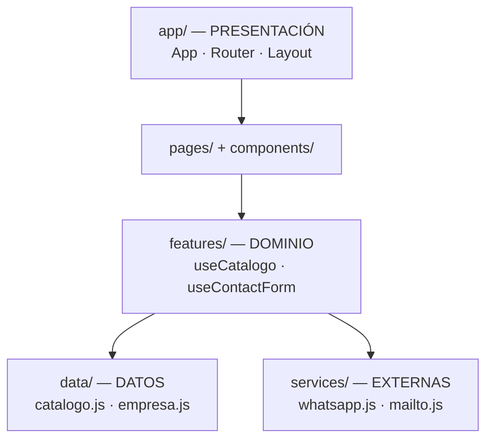

# Guion de Slides — Avance 1 (Semana 8)

> Uso: en PowerPoint / Google Slides, pegar cada bloque como una diapositiva.
> Las imágenes referenciadas están en `docs/wireframes/` y en la demo pública.

---

## 1 · Portada

**Industrias Mazzelli-Perú Cueros E.I.R.L.**
Sitio web corporativo

Proyecto universitario · 7.º ciclo
**Johan Brayan Ramírez Ccoyllo**

`github.com/ramirezjohlo31-rgb/mazzelli-peru-cueros`

---

## 2 · Problemática y justificación

- El taller **no tiene presencia digital**: el catálogo existe solo en piezas físicas y redes sueltas.
- Los clientes mayoristas no encuentran información de materiales, medidas ni precios de forma autónoma.
- La información de contacto (WhatsApp, dirección, horario) está dispersa.
- Necesidad: un canal propio, siempre disponible y con identidad de marca coherente.

**Objetivo:** sitio web corporativo que comunique la marca, exhiba el catálogo y capture contactos.

---

## 3 · Requerimientos

| Funcionales                                          | No funcionales                            |
| ---------------------------------------------------- | ----------------------------------------- |
| RF-01 Navegación principal                           | RNF-01 Responsive mobile-first            |
| RF-02 Página de inicio                               | RNF-02 Performance (bundle < 120 kB gzip) |
| RF-03 Catálogo de productos                          | RNF-03 Accesibilidad WCAG AA              |
| RF-04 Filtro por categoría                           | RNF-04 SEO (metadatos, sitemap)           |
| RF-05 Buscador                                       | RNF-05 Compatibilidad navegador           |
| RF-06 Ordenamiento                                   | RNF-06 Mantenibilidad                     |
| RF-07 Ficha de producto                              | RNF-07 Seguridad y privacidad             |
| RF-08 Contacto por WhatsApp                          | RNF-08 Despliegue reproducible            |
| RF-09 Formulario de contacto                         | RNF-09 Costo cero                         |
| RF-10–RF-12 Contenido institucional, servicios y 404 | RNF-10 Versionado con Git                 |

---

## 4 · Alcance

**Incluido:** 8 vistas · catálogo interactivo · fichas de producto · formulario de contacto · contenido institucional · despliegue público en GitHub Pages.

**Fuera de alcance (Avance 1):** panel de administración, base de datos, carrito de compras, pasarela de pago, multi-idioma.

---

## 5 · Mockups / Wireframes

Insertar: `docs/wireframes/inicio.svg`, `catalogo.svg`, `producto-detalle.svg`, `contacto.svg`

> Mockups de baja fidelidad en SVG, generados con `scripts/generar-wireframes.mjs` para que sean versionados junto al código.

---

## 6 · Arquitectura del sistema



- Las dependencias apuntan **hacia adentro**: la capa de datos no conoce la interfaz.
- Los hooks de dominio no devuelven JSX, solo estado y acciones.
- Cambiar la fuente de datos (a una API) solo afecta a `useCatalogo.js`.

---

## 7 · Elección del stack

| Criterio                     | Vanilla | **React + Vite** | Vue         | Angular     |
| ---------------------------- | ------- | ---------------- | ----------- | ----------- |
| Curva de aprendizaje         | Baja    | Media            | Baja        | **Alta**    |
| Arquitectura por componentes | Manual  | **Nativa**       | Nativa      | Nativa      |
| Peso del bundle              | Mínimo  | **92 kB gzip**   | Bajo        | **~180 kB** |
| Velocidad de build           | N/A     | **Instantánea**  | Instantánea | Lenta       |
| Valor para el mercado        | Básico  | **Máximo**       | Alto        | Alto        |
| Riesgo para el plazo         | Bajo    | **Bajo**         | Bajo        | **Alto**    |

**Decisión: React 19 + Vite 8 + Tailwind CSS v4 + React Router 7.**
El RCU no exige un stack específico; el caso (catálogo + contacto) no justifica el peso de Angular.

---

## 8 · Estructura de carpetas

```
src/
├── app/          Presentación: rutas y layout
├── pages/        8 páginas (lazy-loaded)
├── components/   ui/ (genéricos) y layout/ (navbar, footer)
├── features/     catalogo/ · contacto/  ← dominio
├── data/         catálogo, empresa, servicios
├── services/     whatsapp.js · mailto.js
├── hooks/        useDebounce · useMediaQuery
├── utils/        recursos.js · rutas de los assets de public/
└── styles/       tokens @theme de Tailwind v4
```

---

## 9 · Modelo de datos

- Entidades: **Categoría**, **Producto**, **Variante**, **Imagen**, **Material**, **Empresa**.
- El catálogo vive en `data/catalogo.js`: 12 productos en 5 categorías.
- Sin base de datos en el Avance 1: el modelo está desacoplado para poder migrar a una API sin tocar la interfaz.

Insertar: diagrama ER de `docs/MODELO-DATOS.md`

---

## 10 · Demo en vivo

**URL:** `https://ramirezjohlo31-rgb.github.io/mazzelli-peru-cueros/`

Recorrido sugerido (2 minutos):

1. Portada: hero, categorías, destacados, proceso, garantías.
2. Productos: filtrar por _Carteras_, buscar _cuero_, ordenar por _mayor precio_.
3. Ficha de producto: galería, especificaciones, botón de WhatsApp con mensaje precargado.
4. Contacto: enviar el formulario por WhatsApp y por correo.

---

## 11 · Identidad visual

- **Paleta:** cuero `#3E2A20` · cognac `#8B5E3C` · crema `#FAF6F0` · oro `#C89B3C`.
- **Tipografía:** Playfair Display (títulos) + Inter (texto).
- Iconografía SVG propia, sin dependencias externas.
- Recursos gráficos generados por script y versionados en el repositorio.

---

## 12 · GitHub y buenas prácticas

| Elemento                                                  | Estado |
| --------------------------------------------------------- | ------ |
| Ramas `main` / `develop` + ramas de feature               | ✅     |
| Commits con Conventional Commits                          | ✅     |
| Issues + Projects (Kanban) + Milestones                   | ✅     |
| Pull Requests con revisión                                | ✅     |
| CI/CD: `push` a `main` → deploy automático a GitHub Pages | ✅     |
| README con badges, estructura y capturas                  | ✅     |
| Documentación técnica en `docs/`                          | ✅     |

---

## 13 · Plan de trabajo

| Momento       | Hito              | Entregable                                                           |
| ------------- | ----------------- | -------------------------------------------------------------------- |
| **Semana 8**  | **Avance 1**      | Arquitectura, mockups, esqueleto navegable, repo, CI/CD, URL pública |
| Semanas 9–10  | Desarrollo core   | Contenido real, catálogo completo, productos relacionados            |
| Semanas 11–12 | UX y pulido       | Animaciones, modo oscuro, responsive fino                            |
| Semana 13     | Calidad y SEO     | Lighthouse ≥ 90, accesibilidad, sitemap                              |
| Semana 14     | Release candidate | Pruebas, documentación final, features congeladas                    |
| Semana 15     | Rehearsal         | Ensayo de defensa y slides definitivos                               |
| **Semana 16** | **Entrega final** | Sitio completo, documentado y defender                               |

---

## 14 · Cierre

- **Avance 1 completado:** arquitectura definida, mockups, esqueleto navegable y despliegue automatizado.
- **Riesgos identificados:** material fotográfico del cliente (mitigado con marcadores de posición) y alcance del RCU (contenido en `docs/`).
- **Próximo paso:** contenido real de la empresa y cierre del catálogo.

**Gracias.**
Johan Brayan Ramírez Ccoyllo
`github.com/ramirezjohlo31-rgb`
